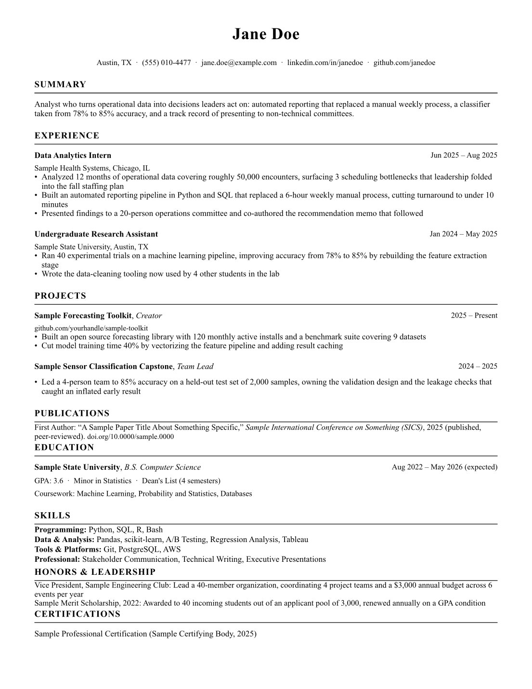

# resume-engine

**Paste a job description into your terminal agent. Get back a validated,
one-page, tailored resume PDF that cannot contain a fact you never gave it.**

Works with Claude Code, Codex CLI, Cursor, Aider, Gemini CLI, or any agent
that can read files and run shell commands.

<p align="center">
  
</p>
<p align="center"><sub>The shipped example, rendered from sample data. Every number on it traces back to a master data entry.</sub></p>

---

## Why this exists

Asking an AI to "tailor my resume to this job" produces a document you then
have to fact-check line by line, because language models round numbers up,
promote you a level, and turn "supported" into "led". Do that thirty times
during a job search and eventually one of those drifts reaches a recruiter.

This repo makes that structurally impossible.

Your facts live in `data/*.yaml`. The AI never writes prose into a resume
directly. It writes a small selection file that references your master entries
**by id**, and a validator rejects it if any number in a bullet does not appear
in the master entry it came from, if it lists a skill you never claimed, or if
it references a job that does not exist. Employer names, job titles, and dates
are pulled from your data at render time, not written by the model at all.

The result: the AI gets to do the part it is good at, which is deciding what
matters for a particular job and rewriting it in that job's vocabulary. It does
not get to decide what is true.

---

## Quickstart

```bash
git clone https://github.com/Tdeniz1/resume-engine-starter.git resume-engine
cd resume-engine
scripts/setup.sh                                        # installs typst, pyyaml, pypdf
RESUME_ALLOW_SAMPLE=1 scripts/render.sh applications/_example
```

That last command builds a sample resume from the shipped sample data. If a
PDF lands in `applications/_example/`, your install works. Its header will say
`FILL_ME` until you enter your own information, which is the next step.

### 1. Load your history

Open `intake/PASTE_YOUR_INFO.md` and dump everything you have: your current
resume, your LinkedIn profile (select all, paste), old job descriptions, project
READMEs, brag docs. Messy and over-detailed is correct. Then start your agent
in this folder and run:

```
/intake
```

The agent converts all of it into structured master data in `data/*.yaml`,
asks you about anything vague, and flags every number as VERIFIED (you have
the artifact), CLAIMED (true to memory, no document), or CONFLICT (your own
sources disagree, so it is unusable until you resolve it).

Prefer to skip the file? Just paste your resume into the chat and say "load
this into my master data". Same result.

### 2. Tailor to a job

Paste the job description into your agent and run:

```
/tailor
```

Or just paste the job description with no command. The agent creates
`applications/<company-role>/`, writes the tailored selection, validates it,
renders the PDF, and tells you what it emphasized and why.

```
applications/acme-data-analyst/Jane_Doe_Acme_DataAnalyst_Resume.pdf
```

Repeat for every job. Each application folder keeps the original job
description alongside the exact resume you sent, so six weeks later you know
what the interviewer is looking at.

---

## Running it with your agent

The instructions live in `AGENTS.md`, which most terminal agents read
automatically. Start your agent **from the repo root** so it picks them up.

| Agent | Setup | Commands |
|---|---|---|
| **Claude Code** | `cd resume-engine && claude` | `/intake`, `/tailor`, or just paste a JD |
| **Codex CLI** | `cd resume-engine && codex` | reads `AGENTS.md`; paste `prompts/tailor.md` |
| **Cursor** | open the folder, use agent mode | reads `AGENTS.md` |
| **Gemini CLI** | `cd resume-engine && gemini` | paste `prompts/tailor.md` |
| **Aider** | `cd resume-engine && aider` | paste `prompts/tailor.md` |
| **Anything else** | run it from the repo root | paste `prompts/intake.md` or `prompts/tailor.md` |

Claude Code gets two extras the others do not: the `/intake` and `/tailor`
slash commands in `.claude/skills/`, and a PostToolUse hook that validates
every `tailored.yaml` the instant it is written, feeding errors straight back
to the model so it self-corrects before you ever see them.

Everywhere else, the same guarantees hold through the scripts. `render.sh`
refuses to build anything that fails validation, so the gate cannot be skipped
by an agent that does not support hooks.

---

## How it fits together

```
data/*.yaml              your facts, written long. the source of truth.
   |
   |  agent selects + rewrites, referencing entries BY ID
   v
applications/<slug>/tailored.yaml     the only file the AI writes per job
   |
   |  scripts/validate.py     rejects invented ids, numbers, and skills
   v
templates/resume.typ + config.yaml    deterministic layout, pulls names and
   |                                  dates from data/ by id
   v
applications/<slug>/Name_Company_Role_Resume.pdf
```

What the validator blocks, as hard errors:

- a `from:` id that does not exist in your master data
- a number in a bullet that does not appear in the master entry it references
- a number in the summary that appears nowhere in your data at all
- a skill that is not in your `data/skills.yaml` inventory
- a resume still pointing at shipped sample data or `FILL_ME` placeholders
- em dashes, the most common AI tell in resume prose (configurable)
- any dated section that is not in reverse chronological order (configurable)

It warns, without blocking, on bullet counts that will not fit one page.

---

## What is in here

```
AGENTS.md              full spec for the agent: rules, intake, tailor
CLAUDE.md              Claude Code pointer to AGENTS.md
config.yaml            font, size, paper, margins, rules, filenames, archiving
data/                  YOUR MASTER DATA (ships with sample entries)
  profile.yaml           contact header
  experience.yaml        jobs, internships, contracts
  education.yaml         schools, degrees, GPA, coursework
  projects.yaml          side projects, research, open source
  skills.yaml            the allowlist. a resume cannot claim what is not here
  publications.yaml      papers, with an honest status field
  honors.yaml            awards, scholarships, leadership
  certifications.yaml    credentials and licenses
intake/
  PASTE_YOUR_INFO.md     the drop box for your raw career history
applications/
  _example/              working sample, renders out of the box
  <company-role>/        one folder per job: jd.txt, tailored.yaml, the PDF
scripts/
  setup.sh               installs dependencies
  validate.py            the anti-hallucination gate
  render.sh              the ONLY build path: validate, compile, page check
  hook_validate.sh       Claude Code PostToolUse hook wrapper
templates/resume.typ     deterministic renderer. never edited per application
prompts/                 copy-paste prompts for agents without slash commands
.claude/                 skills and the validation hook
```

---

## Customizing

Everything you would normally want to change is in `config.yaml`, so you never
have to touch the scripts:

```yaml
render:
  font: ["Times New Roman", "Liberation Serif", "DejaVu Serif"]
  font_size: 9.6        # drop to 9.2 to fit more, raise to 10.2 for less
  paper: "us-letter"    # "a4" for most of the world
  ink: "#000000"
  accent: "#000000"     # headings, rules, bullets. try a navy if you want color

rules:
  no_em_dash: true
  reverse_chronological: true
  max_bullets: 18
  max_pages: 1          # set to 2 for academic CVs

output:
  archive_dir: ""       # e.g. "~/Desktop/Resumes" to collect every PDF in one place
  filename: "{name}_{company}_{role_short}_Resume.pdf"
```

Typst prints a harmless `unknown font family` warning for each font in the list
your machine does not have. The first one it does have wins.

**Section order is per application, not global.** `section_order` in each
`tailored.yaml` decides which sections render and in what order, so a research
application can lead with publications while a sales application drops them
entirely, all from the same master data.

**Layout changes** go in `templates/resume.typ` and apply to every resume you
build from then on. That is the point: an AI cannot restyle one application to
squeeze in an extra line.

---

## Privacy

Your master data is your entire career history, including your phone number
and any numbers you flagged as CLAIMED with notes about why.

**If you fork or clone this publicly, make your copy private before you commit
filled-in data.** The clean way:

```bash
git clone https://github.com/Tdeniz1/resume-engine-starter.git resume-engine
cd resume-engine
rm -rf .git && git init          # cut ties with the public template
gh repo create my-resume-engine --private --source=. --push
```

Nothing in this repo transmits your data anywhere. It is YAML files, a Python
validator, and a Typst compiler, all local. The only thing that sees your
information is the agent you chose to run.

---

## Requirements

- **[Typst](https://github.com/typst/typst)** for PDF compilation:
  `brew install typst`, `cargo install --locked typst-cli`, or
  `winget install --id Typst.Typst`
- **Python 3.9+** with `pyyaml` and `pypdf`:
  `python3 -m pip install --user pyyaml pypdf`
- A terminal agent

`scripts/setup.sh` handles all of it.

---

## Troubleshooting

**"typst is not installed"** — run `scripts/setup.sh`, or install it manually
from the link above.

**"references shipped sample data id"** — you have not replaced the sample
entries in `data/` yet. Run `/intake`. To render anyway while testing, prefix
the command with `RESUME_ALLOW_SAMPLE=1`.

**"'X%' does not appear in the referenced master entry"** — working as
intended. The agent used a number that is not in your data. Either it made the
number up, or the number is real and belongs in `data/` first.

**"is more recent than ... but is listed after it"** — a section is out of
order. Reverse chronological is enforced. Turn it off in `config.yaml` if you
want a functional or skills-first resume.

**The PDF is 2 pages** — cut whole entries rather than trimming every bullet,
or drop `font_size` to 9.2 in `config.yaml`. Three sharp entries beat six thin
ones.

**The header says FILL_ME** — `data/profile.yaml` is still the template.

---

## License

MIT. Use it, fork it, change it. If you build something good on top of it, a
link back is appreciated but not required.
